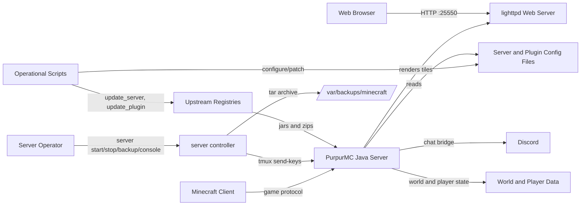
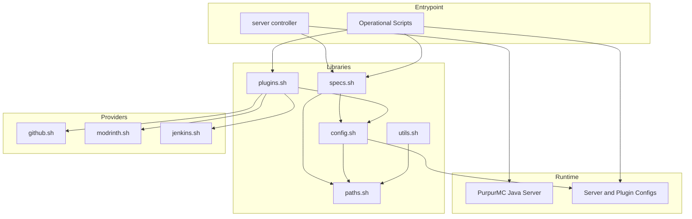
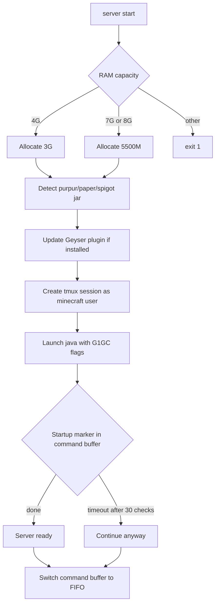
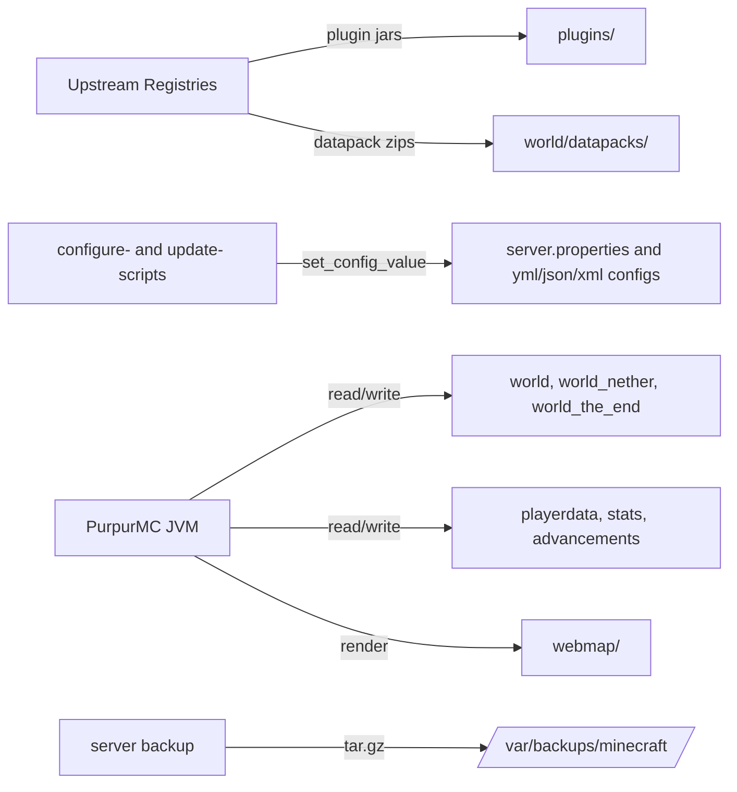
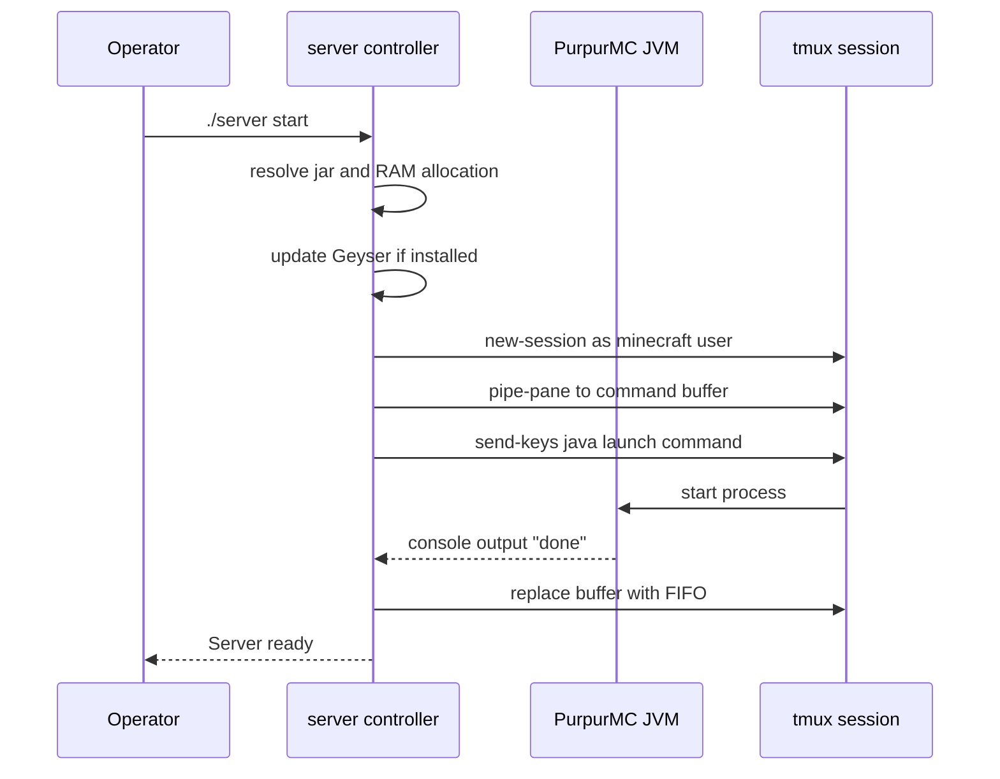
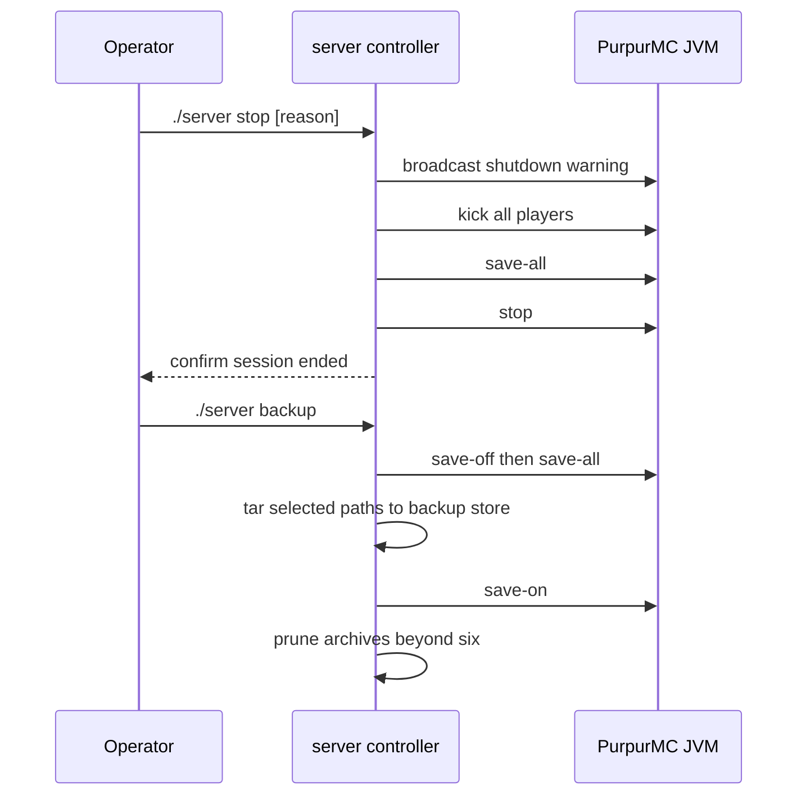
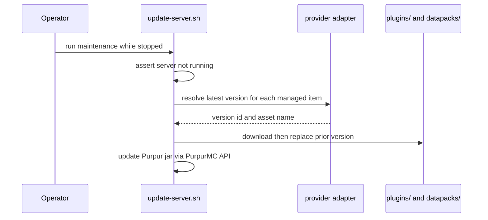
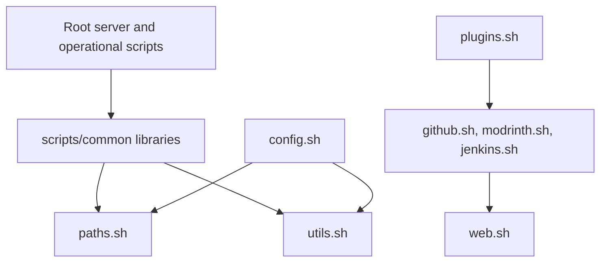

# Minecraft Server on Raspberry Pi Architecture

This document describes the current architecture of the Raspberry Pi 4 Minecraft server repository. It covers the shell-based provisioning and operations toolkit, the hosted PurpurMC runtime it deploys, the configuration surfaces it manages, and the external providers it depends upon. It does not describe Minecraft gameplay mechanics or plugin-internal design.

## 📑 Table of Contents

- [Purpose](#-purpose)
- [System Context](#-system-context)
- [Architectural Style](#-architectural-style)
- [Runtime Process](#-runtime-process)
- [Components](#-components)
- [Architectural Areas](#-architectural-areas)
  - [Repository Root Configuration](#repository-root-configuration)
  - [Operational Scripts](#operational-scripts)
  - [Common Libraries](#common-libraries)
  - [Tests and Automation](#tests-and-automation)
- [Data Architecture](#-data-architecture)
- [Interfaces and Integrations](#-interfaces-and-integrations)
- [Key Processes](#-key-processes)
  - [Server Startup](#server-startup)
  - [Server Shutdown and Backup](#server-shutdown-and-backup)
  - [Server and Plugin Provisioning](#server-and-plugin-provisioning)
  - [Player Username Migration](#player-username-migration)
- [Configuration Provisioning](#-configuration-provisioning)
- [Cross-Cutting Concerns](#-cross-cutting-concerns)
  - [Security and Privacy](#security-and-privacy)
  - [Error Handling](#error-handling)
  - [Observability](#observability)
  - [Configuration](#configuration)
  - [Concurrency and Resource Use](#concurrency-and-resource-use)
- [Dependency Direction and Rules](#-dependency-direction-and-rules)
- [External Dependencies](#-external-dependencies)
- [Deployment and Operations](#-deployment-and-operations)
- [Compatibility Contracts](#-compatibility-contracts)
- [Testing and Verification](#-testing-and-verification)
- [Design Constraints](#-design-constraints)
- [Extension Points](#-extension-points)
  - [Managed Plugin or Datapack](#managed-plugin-or-datapack)
  - [Configuration Script](#configuration-script)
- [Architecture Decisions](#-architecture-decisions)
- [Source Map](#-source-map)
- [Related Documentation](#-related-documentation)

## 🎯 Purpose

The repository's principal responsibility is to define, provision, and operate a single Minecraft server optimised for Raspberry Pi 4 hardware. Its architectural scope spans the operating procedures (start, stop, backup, console access), the declarative configuration of the server and its plugins, the automated acquisition of server binaries, plugins, and datapacks from upstream providers, and the deterministic localisation and settings scripts applied to those artefacts.

The intended audience is the server operator and future maintainers who must understand where runtime, configuration, and provisioning responsibilities live before changing them. The value of recording these boundaries is that the system is a shell-based composition of host-adjacent scripts around a third-party Java process, so its contracts are files, environment variables, and process control rather than compiled interfaces.

## 🌐 System Context

The system boundary is the set of Bash scripts, Jar-backed Java runtime, and configuration files that together form one deployed Minecraft server instance. Initiating actors are the human server operator and connecting Minecraft clients; external systems are the upstream distribution providers (GitHub, Modrinth, Jenkins-based build services, and the PurpurMC REST API), the optional lighttpd web server that serves rendered web maps, and the game's Discord integration. Persistent stores are the world directories, player data, plugin data directories, and backup archives. Material confidence boundary: plugin-internal behaviour is treated as opaque, and the exact set of installed plugins is determined at runtime rather than being fixed in the repository.



The principal external boundaries are:
- **Minecraft Clients:** Connect over the game protocol to the PurpurMC JVM; the server owns sessions, world state, and player data.
- **Upstream Distribution Providers:** GitHub releases/tags, the Modrinth v2 API, Jenkins-style build servers, and the PurpurMC API supply server jars, plugin jars, and datapacks consumed by the provisioning scripts.
- **lighttpd Web Server:** Optional external process serving rendered map tiles on port `25550` from the `webmap` directory.
- **Discord:** Receives chat, join, death, and synchronisation events through the DiscordSRV plugin.
- **Backup Storage:** The local filesystem path `/var/backups/minecraft/` retains timestamped archives outside the repository.

## 🏗️ Architectural Style

The verified style is a shell-based operations toolkit wrapping a third-party host process — a plugin-and-deployment architecture rather than a monolithic application. Configuration is declarative: human-maintained YAML and properties files under version control are mutated by idempotent setter functions at provisioning time. Provider access is abstracted behind adapter libraries so that GitHub, Modrinth, and Jenkins sources share a single update surface, and all scripts share a common path and specification vocabulary sourced at load time.



The principal architecture boundaries are:
- **Entrypoint Layer:** Meets operator intent (`start`, `stop`, `status`, `restart`, `console`, `command`, `backup`) and translates it into tmux session operations against the JVM.
- **Libraries Layer:** Supplies shared vocabulary and side-effecting primitives — filesystem paths, specification constants, configuration setters, and plugin/asset helpers — and must remain free of provider-specific decisions.
- **Providers Layer:** Encapsulates each upstream distribution protocol behind a uniform update contract.
- **Runtime Layer:** The external PurpurMC JVM plus the on-disk configuration it consumes; the repository never links against it.

## 🔄 Runtime Process



The principal runtime sequence is:
1. The controller resolves the server jar, inspects total system RAM, and selects the heap allocation.
2. It conditionally refreshes the Geyser plugin, then creates a detached tmux session owned by the `minecraft` user and launches the JVM with a fixed G1GC flag set.
3. It polls the captured console output for the `done` startup marker, then converts the command buffer from a plain file to a FIFO pipe used for all subsequent console interaction.

## 🧩 Components

| Component | Responsibility | Principal Dependencies | Lifetime or Ownership |
|-----------|----------------|------------------------|-----------------------|
| `server` | Operator entrypoint; start, stop, status, restart, console, command, and backup orchestration. | `specs.sh`, `status.sh`, `utils.sh`, `plugins.sh`, tmux, `sudo -u minecraft`. | Per-invocation process; launches a persistent tmux session. |
| `scripts/common/specs.sh` | Central specification constants: Minecraft version, distances, spawn limits, timings, locale, RAM-derived values. | `config.sh`, `plugins.sh`, `paths.sh`. | Loaded per invocation; exported environment. |
| `scripts/common/config.sh` | Idempotent setters for `.properties`, `.yml`, `.json`, and `.xml` configuration. | `paths.sh`, `utils.sh`, `jq`, `yq`, `xmlstarlet`. | Stateless functions. |
| `scripts/common/plugins.sh` | Plugin/datapack detection, configuration dispatch, download, and update routing. | `config.sh`, `github.sh`, `modrinth.sh`, `jenkins.sh`, `web.sh`, `status.sh`. | Stateless functions. |
| `scripts/common/paths.sh` | Canonical directory and file path exports for the whole toolkit. | None (root of the dependency tree). | Exported environment. |
| `scripts/common/github.sh` | GitHub release/tag resolution and asset download adapter. | `web.sh`, `curl`, `jq`. | Stateless functions. |
| `scripts/common/modrinth.sh` | Modrinth v2 project/version resolution and download adapter. | `web.sh`, `curl`, `jq`. | Stateless functions. |
| `scripts/common/jenkins.sh` | Jenkins `lastSuccessfulBuild` artifact resolution adapter. | `web.sh`, `curl`, `jq`. | Stateless functions. |
| `scripts/configure-settings.sh` | Applies performance and gameplay settings across server and plugin configs. | `specs.sh`, `config.sh`, `plugins.sh`. | Per-invocation script. |
| `scripts/configure-localisation.sh` | Applies locale-dependent strings and messages to server and plugin configs. | `specs.sh`, `messages.sh`, `config.sh`, `plugins.sh`. | Per-invocation script. |
| `scripts/update-server.sh` | Updates the PurpurMC jar, provider-backed plugins, and datapacks. | `plugins.sh`, `specs.sh`, `status.sh`. | Per-invocation script; refuses to run while server is live. |

## 🗂️ Architectural Areas

### Repository Root Configuration

Paths:
- `server.properties`
- `bukkit.yml`
- `spigot.yml`
- `purpur.yml`
- `config/paper-global.yml`
- `config/paper-world-defaults.yml`
- `commands.yml`
- `help.yml`
- `permissions.yml`
- `server`

Responsibilities:
- Hold the declarative server configuration consumed by the PurpurMC runtime.
- Provide the operator entrypoint script at the repository root.

Boundary rules:
- Root configuration files are the source of truth for runtime settings; scripts mutate them rather than introducing parallel copies.
- Secrets and mutable state (`server.properties`, `ops.json`, `whitelist.json`, world directories) are excluded from version control via `.gitignore`.

### Operational Scripts

Paths:
- `scripts/configure-all.sh`
- `scripts/configure-settings.sh`
- `scripts/configure-localisation.sh`
- `scripts/update-server.sh`
- `scripts/fix-permissions.sh`
- `scripts/reset-end.sh`
- `scripts/get-player.sh`
- `scripts/get-players.sh`
- `scripts/get-player-trades.sh`
- `scripts/change-player-username.sh`

Responsibilities:
- Express operator-facing procedures as executable scripts.
- Compose common libraries to mutate configuration, manage files, and query player data.

Boundary rules:
- Operational scripts may depend on any common library; common libraries must not depend on operational scripts.
- Each script sources `paths.sh` first to establish path vocabulary before any other library.

### Common Libraries

Paths:
- `scripts/common/paths.sh`
- `scripts/common/specs.sh`
- `scripts/common/config.sh`
- `scripts/common/plugins.sh`
- `scripts/common/github.sh`
- `scripts/common/modrinth.sh`
- `scripts/common/jenkins.sh`
- `scripts/common/players.sh`
- `scripts/common/messages.sh`
- `scripts/common/colours.sh`
- `scripts/common/utils.sh`
- `scripts/common/status.sh`
- `scripts/common/web.sh`
- `scripts/common/worldguard.sh`
- `scripts/common/rand.sh`

Responsibilities:
- Provide shared, reusable primitives for paths, specifications, configuration, provider access, and presentation.
- Insulate operational scripts from provider-specific and file-format-specific detail.

Boundary rules:
- `paths.sh` is the only unconditional dependency root and may not depend on other libraries.
- Provider adapters (`github.sh`, `modrinth.sh`, `jenkins.sh`) depend only on `web.sh` and configuration utilities, never on each other.
- `plugins.sh` is the only library permitted to route between provider adapters.

### Tests and Automation

Paths:
- `tests/modrinth-tests.sh`
- `.github/workflows/tests.yml`

Responsibilities:
- Verify provider parsing logic without network access.
- Execute every `tests/*-tests.sh` script in continuous integration.

Boundary rules:
- Test scripts must run in isolation from a live server and from external network calls.
- Continuous integration executes the test suite on every push, pull request, and manual dispatch.

## 💾 Data Architecture

The system owns and transforms two data classes: declarative configuration (human-authored and script-mutated) and runtime game state (JVM-owned). Configuration is stored as properties, YAML, JSON, and XML on disk and is mutated in place by format-aware setters. Game state is owned by the JVM and is persisted as world region files, player data, statistics, advancements, and plugin data directories. Downloaded distribution artefacts are content-addressed by name and version. Backups snapshot selected paths to archive files outside the repository.



| Data or Store | Owner | Representation and Storage | Lifecycle or Consistency |
|---------------|-------|----------------------------|--------------------------|
| `server.properties` | PurpurMC runtime | Java properties text at repository root | Mutated by `configure-settings.sh`; excluded from version control. |
| `bukkit.yml`, `spigot.yml`, `purpur.yml`, `config/paper-*.yml` | PurpurMC runtime | YAML at repository root and `config/` | Version-controlled defaults; mutated in place by configuration scripts. |
| Plugin configuration | Individual plugins | YAML/JSON/properties under `plugins/<name>/` | Discovered by `get_plugin_file`; mutated then reloaded via plugin command. |
| World state | PurpurMC runtime | Region and DIM directories under `world/`, `world_nether/`, `world_the_end/` | JVM-owned; snapshotted by backup with `save-off`/`save-all`. |
| Player data | PurpurMC runtime and plugins | `playerdata`, `stats`, `advancements`, plus per-plugin caches | Keyed by player UUID; migrated by `change-player-username.sh`. |
| Downloaded artefacts | Provisioning scripts | Jar and zip files under `plugins/` and `world/datapacks/` | Replaced when a newer upstream version is detected; prior version removed. |
| Backup archives | `server` controller | `tar.gz` files under `/var/backups/minecraft/<session>/` | Retains the most recent six archives; older archives pruned. |

## 🔌 Interfaces and Integrations

| Interface or Integration | Direction | Contract | Owner | Failure Semantics |
|--------------------------|-----------|----------|-------|-------------------|
| Operator command interface | Inbound | `server {start\|stop\|status\|restart\|console\|command\|backup}` positional argument. | `server` controller | Unknown commands print a message and exit; unsupported RAM aborts with exit code 1. |
| tmux session control | Outbound | Detached session named after the repository directory; command delivery via `send-keys` and `pipe-pane`. | `server` controller | Missing session is reported; startup timeout continues with a warning. |
| Minecraft game protocol | Inbound | PurpurMC-managed TCP connectivity on the server port. | PurpurMC runtime | Managed by the JVM; `connection-throttle` limits reconnect abuse. |
| PurpurMC REST API | Outbound | `GET https://api.purpurmc.org/v2/purpur/<version>` for latest build resolution. | `update-server.sh` | Empty result short-circuits the update. |
| Modrinth v2 API | Outbound | Project, version, and CDN download endpoints, filtered by loader (`paper`, `spigot`, `bukkit`, `datapack`). | `modrinth.sh` | Empty version id skips download. |
| GitHub releases and tags API | Outbound | `GET releases` then `GET tags`; asset URL composed from tag and name pattern. | `github.sh` | `null` or empty tag skips download; prereleases excluded by default. |
| Jenkins-style build servers | Outbound | `lastSuccessfulBuild/api/json` artifact resolution with fallback artifact paths. | `jenkins.sh` | Empty version skips download. |
| lighttpd web server | Outbound | HTTP on port `25550` serving the `webmap` directory. | External host process | Documented in `README.md`; map pages unavailable if not configured. |
| Discord chat bridge | Outbound | DiscordSRV plugin webhooks and account linking. | DiscordSRV plugin | Ownership delegated to the plugin; account UUIDs rewritten by username migration. |

## 🔀 Key Processes

### Server Startup



Ordering is significant: the session is created before the JVM launch so that console capture begins before startup output is emitted; the command buffer transitions from file to FIFO only after the startup marker is observed.

### Server Shutdown and Backup



A live server is quiesced with `save-off` before the archive is created and resumed with `save-on` afterwards; when the server is stopped the archive is created without save toggling.

### Server and Plugin Provisioning



The update refuses to proceed while `IS_SERVER_RUNNING` is true, ensuring artefacts are not replaced under a live JVM.

### Player Username Migration

```mermaid
sequenceDiagram
  participant Op as Operator
  participant Mig as change-player-username.sh
  participant FS as Player and plugin data
  Op->>Mig: old-username new-username
  Mig->>Mig: resolve UUIDs; refuse if new data exists
  Mig->>FS: rewrite UUID references in Discord, WorldGuard, whitelist
  Mig->>FS: move Essentials, SkinsRestorer, TradeShop, world data
  Mig->>Mig: reload affected plugins
  Mig->>Mig: reapply permissions
```

Migration fails closed: if any target file already exists for the new UUID or username, the process aborts before mutating state.

## ⚙️ Configuration Provisioning

Configuration is applied by two idempotent scripts. `scripts/configure-settings.sh` writes performance and gameplay values into `server.properties`, `bukkit.yml`, `spigot.yml`, `purpur.yml`, `config/paper-global.yml`, and `config/paper-world-defaults.yml`, and dispatches plugin-specific settings through `configure_plugin`. `scripts/configure-localisation.sh` selects a locale branch (`ro` or `en`), constructs locale-dependent messages, and writes them into server and plugin configuration and message files.

Both scripts depend on `set_config_value` and `set_config_values`, which select a format-specific writer by file extension: `set_json_value` for `.json`, `set_xml_value` for `.xml`, `set_yml_value` for `.yml`/`.yaml`, and a `sed`-based writer for properties and other text. `configure-all.sh` invokes the settings and localisation scripts in sequence. Empty values delete keys; non-existent files are silently skipped, making the operation safe to run repeatedly.

## 🧵 Cross-Cutting Concerns

### Security and Privacy

Trust boundaries exist between the operator (with `sudo` or `minecraft` privileges), the network clients connecting to the game server, and the external providers contacted over HTTPS. The `server` controller requires the `minecraft` user and validates this with an explicit identity check before proceeding. `run_with_privileges` centralises elevation and only escalates when not already root or the `minecraft` user. Provider access uses HTTPS to public endpoints without embedded credentials. Sensitive and mutable server files (`server.properties`, `ops.json`, `whitelist.json`, `banned-*.json`, `eula.txt`, world and plugin directories) are excluded from version control. Capability overhead is reduced by disabling telemetry by default (`USE_TELEMETRY=false`, `bStats` server UUID zeroed, `timings` disabled).

### Error Handling

Scripts generally `set -e` (in `server`) or rely on explicit guards. Configuration writers no-op on missing files and emit diagnostics to standard error for invalid argument counts, missing utilities (`jq`, `yq`, `xmlstarlet`), and privilege failures. Update functions short-circuit when a provider returns no version. The `server` controller distinguishes fatal startup failure (dead session, exit code 1) from a startup timeout that is downgraded to a warning. The startup sequence relies on `set -u` and `set -e` to avoid acting on unset variables and to stop on unhandled command failure.

### Observability

Runtime diagnostics are human-facing console output with colourised status markers, captured in a per-session command buffer and the server's `logs/latest.log`. Utility helpers `find_in_logs` and `convert_ticks_to_duration` support operator inspection of logs and timing values. There is no metrics exporter, tracing, or health endpoint beyond the plugin-level performance hooks that are deliberately disabled. Log output may contain player identifiers and must be handled as sensitive.

### Configuration

| Configuration Area | Source | Responsibility | Supersede or Secret Policy |
|--------------------|--------|----------------|---------------------------|
| Specification constants | `scripts/common/specs.sh` | Distances, spawn limits, timings, locale, RAM-derived values. | Exported environment; consumed by configuration scripts. |
| Server runtime settings | `server.properties`, `bukkit.yml`, `spigot.yml`, `purpur.yml`, `config/paper-*.yml` | Authoritative runtime behaviour. | Mutated in place; `server.properties` excluded from version control. |
| Plugin configuration | `plugins/<name>/` files | Per-plugin behaviour and messages. | Discovered and mutated by `configure_plugin`; reloaded via plugin command. |
| Locale | `LOCALE` in `specs.sh` (`ro` default, `en` fallback) | Selects localised message branch. | Single source; drives both server and plugin localisation. |
| Provider endpoints | Hard-coded URLs in scripts | Upstream distribution source selection. | Public HTTPS; no embedded credentials. |

### Concurrency and Resource Use

The primary concurrency boundary is the single JVM process controlled through one tmux session; all console interaction is serialised through a FIFO command buffer. The existing `clean-server-properties` background job runs on a short delay to strip comments and sort `server.properties`. Heap allocation is derived from total system RAM (3G on 4G systems, 5500M on 7–8G systems) and enforced with fixed `-Xms`/`-Xmx`. Chunk threads are bounded (`paper.maxChunkThreads=3`), and view/simulation distances are clamped to validated minimum and maximum bounds in `specs.sh`. Backups temporarily disable saving to obtain a consistent snapshot and prune archives beyond the retention count.

## 🧭 Dependency Direction and Rules



The principal dependency rules are:
- Root scripts and operational scripts may depend on any common library; common libraries must never depend on root or operational scripts.
- `paths.sh` is the dependency root and must not source other libraries.
- Provider adapters depend only on `web.sh` and configuration utilities; they must not depend on one another.
- Only `plugins.sh` may route between provider adapters.
- Libraries must not embed provider-specific branching outside the adapter that owns that provider.

## 📦 External Dependencies

| Dependency | Responsibility | Integration Boundary | Architectural Consequence |
|------------|----------------|----------------------|---------------------------|
| PurpurMC (Paper fork) | Minecraft server runtime and API for build resolution. | `server` controller and `update-server.sh`. | Filesystem-deployed jar; replaced by version name; no compile-time coupling. |
| Java runtime | Executes the server with G1GC flags. | Host environment. | RAM and thread flags are fixed by the controller. |
| `jq` | JSON parsing for provider and configuration operations. | `config.sh`, `modrinth.sh`, `github.sh`, `jenkins.sh`. | Required host utility; presence validated at load. |
| `yq` | YAML editing for server and plugin configuration. | `config.sh`. | Required for YAML writes; absence yields a diagnostic. |
| `xmlstarlet` | XML editing for XML-format plugin configuration. | `config.sh`. | Required host utility. |
| `tmux` | Session management, console capture, and command delivery. | `server` controller. | Central to startup, shutdown, and console access. |
| `tar` | Backup archive creation. | `server` controller. | Required for backups; absence aborts backup with an error. |
| `curl` and `wget` | Provider API requests and artefact download. | `web.sh`, provider adapters. | Network egress to upstream providers. |
| lighttpd | Serves rendered web maps on port `25550`. | External host process. | Optional; only required for map plugins. |
| DiscordSRV | Discord bridge for chat and events. | Plugin boundary. | Plugin-owned integration; UUID references rewritten during migration. |

## 🚀 Deployment and Operations

The deployment model is a single self-hosted server instance on a Raspberry Pi 4 running a Linux-based OS. The repository is deployed onto the host filesystem; the `server` controller launches the JVM as the `minecraft` user inside a detached tmux session. Persistent state lives in world directories, plugin data directories, and the local backup path. There is no containerisation, orchestration, or horizontal scaling; capacity is bounded by the single Pi's RAM and CPU threads.

| Concern | Current Design | Architectural Consequence |
|---------|----------------|---------------------------|
| Process topology | One JVM managed via one tmux session named after the repository directory. | Single point of control; there is no multi-instance supervision. |
| Resource provisioning | Heap derived from total RAM; distances and spawn limits clamped in `specs.sh`. | Tuned for Raspberry Pi 4; unsupported RAM sizes abort startup. |
| Persistent state | World directories, plugin data, and `server.properties` on the host filesystem. | State is host-bound; migration requires filesystem-level handling. |
| Backup and recovery | Timestamped `tar.gz` archives under `/var/backups/minecraft/`, last six retained. | Recovery is manual; retention is bounded by the archive count. |
| Availability | No automatic restart or health supervision. | Restoration depends on the operator re-running `server start`. |
| Permissions | Files owned by `minecraft:minecraft`; elevation via `run_with_privileges`. | Correct ownership is required for the scripts to operate. |

## 🛡️ Compatibility Contracts

| Contract | Owner | Invariant | Verification | Change Policy |
|----------|-------|-----------|--------------|---------------|
| `server` command vocabulary | `server` controller | `start`, `stop`, `status`, `restart`, `console`, `command`, `backup` remain the accepted first argument. | Manual invocation; referenced in `README.md`. | Additive changes only; removal requires operator notice. |
| Specification variable names | `scripts/common/specs.sh` | Exported names consumed by configuration scripts remain stable. | Consumption across `configure-*.sh`. | Rename only with synchronised updates to all consumers. |
| Path vocabulary | `scripts/common/paths.sh` | Exported path variable names and layout remain stable. | Sourced by every library. | Additive changes only. |
| Configuration key paths | `configure-settings.sh`, `configure-localisation.sh` | Dotted key paths must match the target file schema. | Applying scripts against live configuration files. | Change when the upstream file schema changes. |
| Modrinth loader filtering | `scripts/common/modrinth.sh` | Plugin versions filter on `paper`/`spigot`/`bukkit`; datapacks on `datapack`. | `tests/modrinth-tests.sh`. | Preserve filter semantics; extend loaders only with test coverage. |
| Filename placeholders | `plugins.sh`, `github.sh`, `jenkins.sh` | `%pluginName%`, `%pluginVersion%`, `%datapackName%`, `%datapackVersion%` expansion semantics. | Asset download naming. | Extend only additively. |

## ✅ Testing and Verification

Automated verification operates at the unit level on provider parsing logic. `tests/modrinth-tests.sh` isolates `get_latest_modrinth_version_id` by stubbing `curl`, then asserts loader-based selection across `paper`, `spigot`, `bukkit`, and `datapack`, including large-response and empty-response cases and the fallback ordering used for non-plugin project types. There is no automated verification of the `server` controller, the configuration writers, or the live runtime; those remain manual operator procedures. A material coverage gap is that privilege-dependent and provider-network behaviour is exercised only on the host.

Execute the principal automated verification with:

```bash
for TEST_SCRIPT in tests/*-tests.sh; do
    bash "${TEST_SCRIPT}"
done
```

## ⚠️ Design Constraints

- **Raspberry Pi 4 capacity:** Heap allocation only supports total RAM of 4G or 7–8G; other sizes abort startup. The design deliberately trades availability on unsupported hardware for predictable performance.
- **Single-instance control:** One JVM is managed through one tmux session; there is no supervision, clustering, or multi-instance orchestration.
- **Runtime-determined plugin set:** The installed plugin inventory is discovered from `plugins/` at execution time, so configuration scripts must guard every plugin-specific write with `is_plugin_installed`.
- **Host utility coupling:** Correct operation requires `jq`, `yq`, `xmlstarlet`, `tmux`, `tar`, `curl`, and `wget` on the host; absence of a required utility produces a diagnostic or aborts.
- **Network dependency for provisioning:** Server binaries, plugins, and datapacks are fetched from upstream providers over the network; offline maintenance cannot update artefacts.
- **No automated runtime tests:** Coverage is limited to provider parsing; controller and configuration behaviour are verified manually.

## 🔧 Extension Points

### Managed Plugin or Datapack

1. Add an `update_plugin` or `update_datapack` entry in `scripts/update-server.sh` with the provider URL and asset filename pattern.
2. Guard any configuration writes with `is_plugin_installed` or `is_datapack_installed` so absence is tolerated.
3. Apply settings through `configure_plugin` in `configure-settings.sh` or `configure-localisation.sh`, preserving the provider-adapter and configuration-writer conventions.

The extension must keep provider routing inside `plugins.sh` and its adapters, use repository-relative path variables from `paths.sh`, and never introduce provider-specific branching into unrelated libraries.

### Configuration Script

1. Implement the new procedure in `scripts/` sourcing `paths.sh` first and any required common libraries afterwards.
2. Route all file mutations through `set_config_value`/`set_config_values` so format handling remains centralised.
3. Reapply `fix-permissions.sh` after changing file ownership, and add the script to any orchestration such as `configure-all.sh` if it belongs to the standard provisioning sequence.

The extension must preserve the `minecraft` user ownership convention and the idempotent, missing-file-tolerant behaviour of existing configuration scripts.

## 📝 Architecture Decisions

| Decision | Rationale | Consequence | Record |
|----------|-----------|-------------|--------|
| Manage the runtime through tmux rather than a service manager | Provides persistent console access, scriptable command delivery, and screen-like session semantics. | Operator experience is coupled to the tmux session name; no automatic restart or supervision. | Documented here |
| Abstract distribution providers behind adapters | GitHub, Modrinth, and Jenkins sources differ in protocol but share download semantics. | Adding a provider requires only a new adapter and routing in `plugins.sh`. | Documented here |
| Mutate configuration in place with format-aware setters | Keeps a single authoritative configuration file per target and avoids templating divergence. | Changes depend on matching dotted key paths against each file's schema. | Documented here |
| Derive performance values from hardware in `specs.sh` | Reserves tuning knowledge from the Raspberry Pi 4 target in one place. | Values are recomputed by script rather than being hand-edited per file. | Documented here |
| Disable telemetry and profiler hooks by default | Reduces overhead and avoids external reporting on constrained hardware. | Providers and operators must opt in explicitly. | Documented here |

## 🗺️ Source Map

| Area | Path |
|------|------|
| Operator entrypoint | `server` |
| Operational scripts | `scripts/` |
| Common libraries | `scripts/common/` |
| Root server configuration | `server.properties`, `bukkit.yml`, `spigot.yml`, `purpur.yml`, `commands.yml`, `help.yml`, `permissions.yml` |
| Paper configuration | `config/` |
| Automated tests | `tests/` |
| Continuous integration | `.github/workflows/tests.yml` |

## 📚 Related Documentation

- [README.md](README.md) documents prerequisites, installation, web server setup, configuration, and usage for operators.
