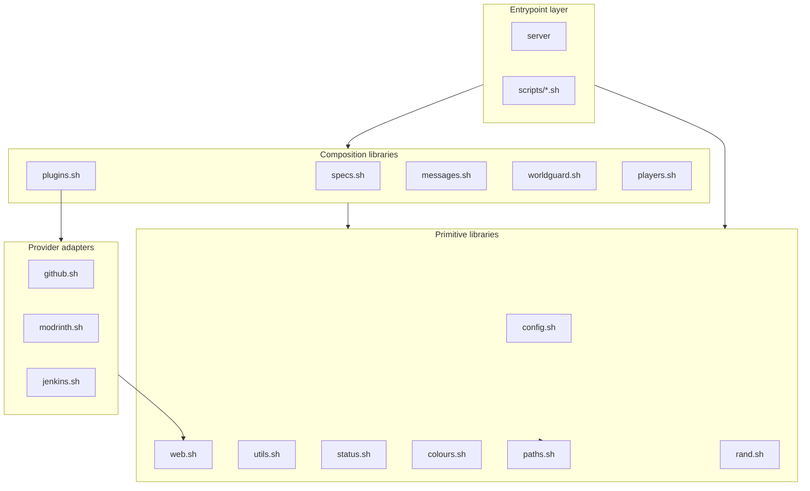
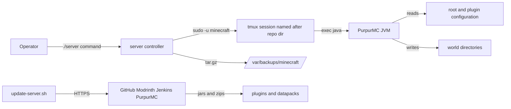

# Architecture

This document elaborates on [`ARCHITECTURE.md`](../ARCHITECTURE.md) with implementation-level detail. It does not reproduce the root document; read that first for system context, component tables, and process diagrams.

## Layered model

The toolkit is a strict four-layer stack. Dependencies flow downward only.

### Entrypoint layer

- `server` — process lifecycle control (tmux + JVM + console).
- `scripts/*.sh` — one-shot operator procedures.

### Composition libraries

Libraries that combine primitives into domain operations:

- `specs.sh` — computes and exports the specification vocabulary.
- `plugins.sh` — plugin/datapack detection, configuration, and update routing.
- `messages.sh` — message construction from colour vocabulary and locale.
- `worldguard.sh` — region-aware message and flag generation.
- `players.sh` — player identity, cache, and reporting.

### Primitive libraries

- `paths.sh` — the dependency root; exports the path vocabulary and depends on nothing.
- `config.sh` — format-aware configuration writers and readers.
- `web.sh` — artefact download.
- `utils.sh` — privileges, conversions, file helpers, command dispatch.
- `status.sh` — computes `IS_SERVER_RUNNING`.
- `colours.sh` — colour vocabulary only.
- `rand.sh` — random helpers only.

### Provider adapters

`github.sh`, `modrinth.sh`, and `jenkins.sh` each translate one upstream distribution protocol into the uniform `update_plugin*` / `download_plugin*` contract. They depend on `web.sh` and, for GitHub/Jenkins, on the shared `transform_asset_file_name` convention. They never depend on one another.

## Dependency rules

1. Root scripts and operational scripts may depend on any common library.
2. Common libraries must never depend on root or operational scripts.
3. `paths.sh` is the dependency root and sources nothing.
4. Provider adapters depend only on `web.sh` (and configuration utilities); they must not depend on each other.
5. Only `plugins.sh` routes between provider adapters.
6. Provider-specific branching must not leak outside the adapter that owns that provider.

The codebase observes these rules with two documented deviations, recorded in [ambiguities-and-open-questions.md](./ambiguities-and-open-questions.md): `jenkins.sh` defines `transform_asset_file_name` while `plugins.sh` defines `transform_plugin_asset_file_name` (duplicate naming helpers), and `download_file` in `web.sh` internally performs `chown` (a privilege concern).

## Runtime topology

## Configuration approach

Configuration is mutated in place, never templated. A single authoritative file per target is read, edited, and written by a format-specific setter selected from the file extension. This keeps the on-disk file as the source of truth but couples correctness to matching dotted key paths with each file's schema. See [components/configuration-writers.md](./components/configuration-writers.md).

## Related documentation

- [flows/](./flows/) for end-to-end executions.
- [invariants.md](./invariants.md) and [dependencies.md](./dependencies.md).
