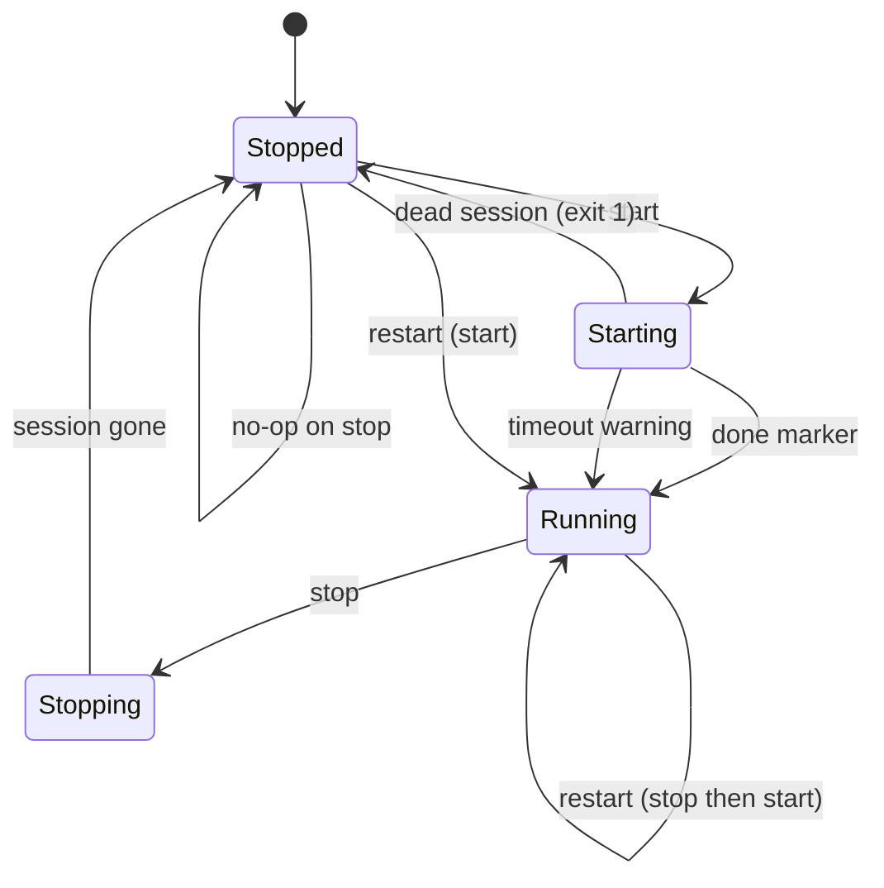

# Behaviour: server lifecycle

Operators interact with the runtime exclusively through the `server` controller. This document summarises the observable behaviour of each action.

## State model

State is determined by two independent signals:

- The controller's tmux session existence (`socket_has_session`).
- The toolkit-wide `IS_SERVER_RUNNING` (`status.sh`) from `ps aux`.

## Action semantics

| Action | Effect | Idempotency |
|--------|--------|-------------|
| `start` | Geyser refresh; new detached session; JVM launch; startup poll | Warns and no-ops if a session exists |
| `stop [reason]` | Broadcast → 30 s wait → kickall → save-all → stop → wait | No-ops (message) if no session |
| `status` | Prints running/stopped; RSS summary when running | Read-only |
| `restart` | Stop (if running) then start | — |
| `console` | Attaches to the session | No-ops if no session |
| `command <cmd…>` | Sends a console command; returns output | Error if no args or no session |
| `backup` | Save-toggled tar; retention prune | Error if `tar` missing |

## Player notification

Stop broadcasts use `essentials:broadcast` and `broadcast`, and honour `LOCALE` for Romanian or English text. A caller-provided reason becomes part of the kick message.

## Shutdown durability

The controller waits up to 10 seconds (100 × 0.1 s) for the session to vanish after `stop`. If it does not, it reports a timeout but the JVM may still be finishing; the operator should confirm with `status`.

## Related documentation

- [components/server-controller.md](../components/server-controller.md)
- [flows/startup.md](../flows/startup.md), [flows/shutdown-and-backup.md](../flows/shutdown-and-backup.md)
