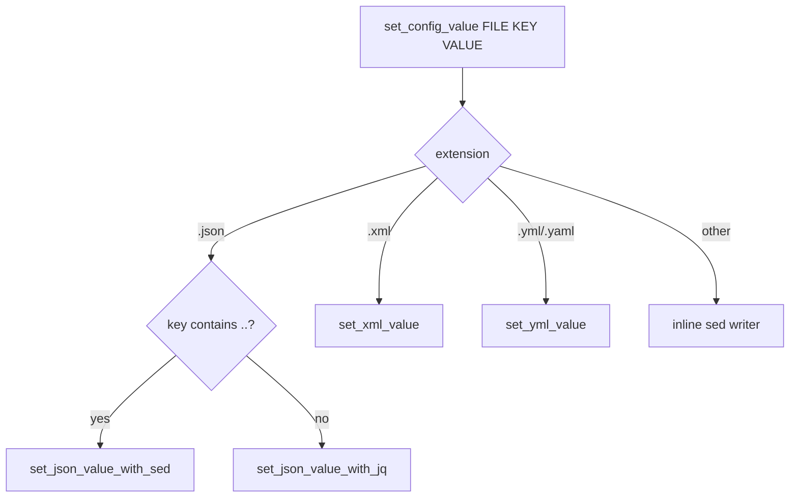

# Configuration writers

**File:** `scripts/common/config.sh`.

## Purpose

Provide format-aware, idempotent mutation of configuration files so operational scripts never manipulate file formats directly.

## Public interface

| Function | Signature | Behaviour |
|----------|-----------|-----------|
| `set_config_values` | `FILE [KEY VALUE]...` | Batch apply; errors on odd argument count; skips empty keys. |
| `set_config_value` | `FILE KEY VALUE` | Dispatches by extension. |
| `set_json_value` | `FILE KEY VALUE` | `jq` writer, or `sed` writer when `KEY` contains `..`. |
| `set_xml_value` | `FILE KEY VALUE` | `xmlstarlet` writer with namespace detection. |
| `set_yml_value` | `FILE KEY VALUE` | `yq` writer, deleting on empty value. |
| `delete_yml_setting` | `FILE KEY` | `del(.key)`. |
| `apply_yml_config` | `FILE YQ_COMMAND` | Runs a raw `yq` expression. |
| `get_config_value` / `get_yml_value` | `FILE KEY` | Reads a dotted or simple key. |
| `set_gamerule` | `RULE VALUE` | Sends `gamerule` through `run_server_command`. |
| `check_if_utility_exists` | `NAME` | Exits 400 if `/usr/bin/NAME` is missing. |

## Dispatch

## Writer details

### Properties / plain text (inline `sed`)

- Escapes the value for `sed` and swaps `=`/`:` separators.
- Updates an existing `KEY =`/`KEY :` line in place, or appends `KEY=VALUE`.
- Uses `run_with_privileges` when the file is not writable.

### YAML (`set_yml_value`)

- Empty value → delete the key.
- Quotes the value when it is not a bare boolean/number/`[...]`.
- Dotted keys produce a bracketed `yq` path expression (e.g. `world-settings.default.…` → `["world-settings"].["default"]…`).
- Requires `/usr/bin/yq`; reports an error and returns if absent.

### JSON (`set_json_value_with_jq`)

- Quotes values unless they are boolean/number.
- Empty value → `del(.key)`.
- Writes to a temp file, then copies back — avoiding partial writes.
- Requires `/usr/bin/jq`.

### JSON with `sed` (`set_json_value_with_sed`)

Used when the key contains `..` (which `jq` path escaping cannot express). Escapes `.` to `\.` and replaces the quoted value on the matching line.

### XML (`set_xml_value`)

- Detects the default namespace (`xmlns=`) and rewrites the node path with the `x:` prefix when present.
- Compares the current value with `xmlstarlet sel` and only edits on change.
- Requires `xmlstarlet`.

## Idempotency and safety

- Missing files → silent return.
- Unchanged values (XML) → no write.
- Native writers use privileged execution only when the file is not writable.
- Empty strings delete keys, enabling clearing of region flags and messages.

## Related documentation

- [configuration.md](../configuration.md)
- [flows/configuration.md](../flows/configuration.md)
