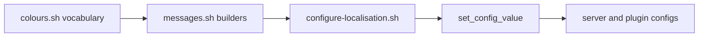

# Messaging and localisation

**Files:** `scripts/common/colours.sh`, `scripts/common/messages.sh`, and the localisation script `scripts/configure-localisation.sh`.

## Purpose

Provide a single colour and message vocabulary so that every user-facing string written into server or plugin configuration has a consistent style, and produce bilingual (Romanian/English) variants of all messages.

## Composition

- `colours.sh` — pure vocabulary; defines Minecraft section-sign codes (`§a`), hex codes, MiniMessage tags (`<green>`), and shell escapes (`\e[1;32m`), plus composed aliases (`COLOUR_MESSAGE`, `COLOUR_SUCCESS`, `COLOUR_ERROR`, `COLOUR_PLAYER`, `COLOUR_PLUGIN`, `COLOUR_SETTLEMENT`, …).
- `messages.sh` — message builders that combine a category symbol, a status colour, and normalised text.

## Message builders

| Builder | Output shape |
|---------|--------------|
| `get_formatted_message <status> <category> <text>` | `SYMBOL ` + coloured text (`status` ∈ info/success/error). |
| `get_formatted_message_minimessage` | MiniMessage conversion of the above. |
| `get_action_message`, `get_announcement_message` | Player/announcement styles. |
| `get_reload_message`, `get_reloading_message`, `get_plugin_enablement_message`, `get_plugin_linked_message` | Plugin lifecycle messages (localised). |
| `get_enablement_message <status>` | Colours an enable/disable word (ro: `activ*`/`dezact*`; en: `enabl*`/`disabl*`). |
| `get_coloured_message`, `get_highlighted_message`, `get_obscured_message` | Wrapping helpers. |
| `get_{player,plugin,location,command}_mention` | Entity highlighting. |
| `normalise_message` | Appends punctuation, escapes quotes. |
| `get_symbol_by_category` / `match_category_to_symbol` | Maps a category to an emoji/symbol (e.g. `auth` → 🔑, `combat` → 🗡, `error` → ✘, `success` → ✔). |

## Localisation mechanism

`configure-localisation.sh` selects a branch on `LOCALE`:

- `ro` → Romanian strings; `WEBMAP_PAGE_TITLE="Harta ${SERVER_NAME}"`.
- else → English strings.

Both branches define the same variable set (`INVALID_ACTION_MESSAGE`, `DISCONNECTED_MESSAGE`, `NOT_ENOUGH_MONEY_MESSAGE`, `JOIN_MESSAGE`, `QUIT_MESSAGE`) and MiniMessage variants, then write them into server and plugin configuration via `set_config_value`/`configure_plugin`.

## Placeholders

The localisation script defines a large set of placeholder constants (`{PLAYER}`, `%player%`, `%achievement%`, `%count%`, `{sales}`, `<name>`, `%message%`, …) used verbatim in message values consumed by plugins. These must be preserved exactly.

## Conversion helpers

- `convert_message_to_minimessage` — maps section-sign codes to MiniMessage tags.
- `convert_message_to_ampersand` — maps `§` to `&` (for item lore).

## Related documentation

- [flows/configuration.md](../flows/configuration.md)
- [invariants.md](../invariants.md) (placeholder fidelity)
