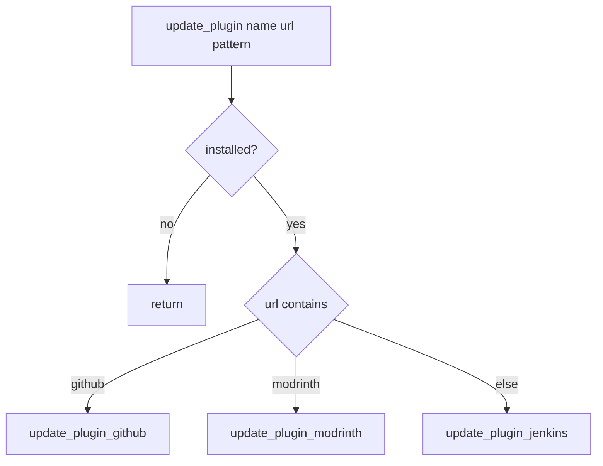

# Plugin management

**File:** `scripts/common/plugins.sh`.

## Purpose

Detect installed plugins and datapacks, discover their configuration files, apply configuration, and route update requests to the correct provider adapter. This is the only library permitted to route between provider adapters.

## Detection

| Function | Rule |
|----------|------|
| `is_plugin_installed <name>` | A file matches `plugins/<name>-*.jar`. |
| `is_datapack_installed <name>` | A file matches `world/datapacks/<name>*.zip`. |
| `is_plugin_installed_bool` / `is_plugin_not_installed_bool` | Boolean string output for config values. |
| `ensure_plugin_is_installed <name>` | Exits 1 when absent. |

Detection is filesystem-based: the installed set is determined at runtime and is not fixed in the repository.

## Directory-name mapping

`get_plugin_dir <name>` maps display names to on-disk directory names:

| Plugin name | Directory |
|-------------|-----------|
| `Dynmap` | `dynmap` |
| `EssentialsX` | `Essentials` |
| `Geyser` | `Geyser-Spigot` |
| `InvSee++` | `InvSeePlusPlus` |
| `NuVotifier` | `Votifier` |
| `WolfyUtils` | `WolfyUtilities` |

All other names map to themselves.

## Configuration-file discovery

`get_plugin_file <name> <hint>` returns the resolved path:

1. The hint as-is (if it is a real file).
2. `<pluginDir>/<hint>`.
3. If the hint is `config`, the first existing of `config.yml`, `Config.yml`, `config.json`, `configuration.txt`, `main.yml`, `options.yml`, `Settings.yml`, `settings.yml`.
4. If the hint is `messages`, the first existing of `i18n/en.properties`, `lang/strings.json`, `languages/lang.en.yml`, `language.yml`, `lang_en.yml`, `messages.yml`, `Messages.yml`.

Returns nothing when the plugin is not installed or its directory is missing.

## Configuration dispatch

`configure_plugin <name> <hint> [key value]...`:

1. Return unless the plugin is installed.
2. Resolve the file via `get_plugin_file`.
3. Apply values with `set_config_values`.
4. Reload the plugin.

`reload_plugin <name>` returns unless `IS_SERVER_RUNNING` and the plugin is installed. It lowercases the plugin name to form the command and applies special cases:

| Plugin | Command | Notes |
|--------|---------|-------|
| `GSit` | `gsitreload` | no sub-command |
| `Chatbubbles` | `cbreload` | no sub-command |
| `AnarchyExploitFixes` | `aef reload` | alias |
| `ChestShopNotifier` | `csn reload` | alias |
| `EssentialsX` | `essentials reload` | alias |
| `InvSee++` | `invsee reload` | alias |
| `KeepInventoryCost` | `keepinventoryadmin reload` | alias |
| `LuckPerms` | `luckperms reloadconfig` | different sub-command |
| `VotingPlugin` | `av reload` | alias |

## Download and placement

- `download_plugin <url> <name> <version>` — skips if the target exists; downloads to `plugins/.temp`, removes prior `<name>-*.jar`, moves into place, chowns `minecraft:minecraft`, chmods `+x`.
- `download_datapack <url> <name> <version>` — removes prior `<name>-*.zip`, downloads to `world/datapacks/<name>-<version>.zip`.
- `transform_plugin_asset_file_name` substitutes `%pluginName%`, `%pluginVersion%`, `%dataPackName%`, `%dataPackVersion%`.

## Update routing

`update_plugin <name> <url> <asset_pattern> [allow_prereleases]` and `update_datapack <name> <url> [asset_pattern]`:

- Return unless installed.
- Default patterns: `%pluginName%-%pluginVersion%.jar` and `%datapackName%-%datapackVersion%.zip`.
- URL containing `github` → GitHub adapter.
- URL containing `modrinth` → Modrinth adapter.
- Otherwise → Jenkins adapter (plugins only; datapacks only recognise Modrinth).

## Related documentation

- [components/provider-adapters.md](./provider-adapters.md)
- [flows/provisioning.md](../flows/provisioning.md)
- [behaviour/artefact-updates.md](../behaviour/artefact-updates.md)
