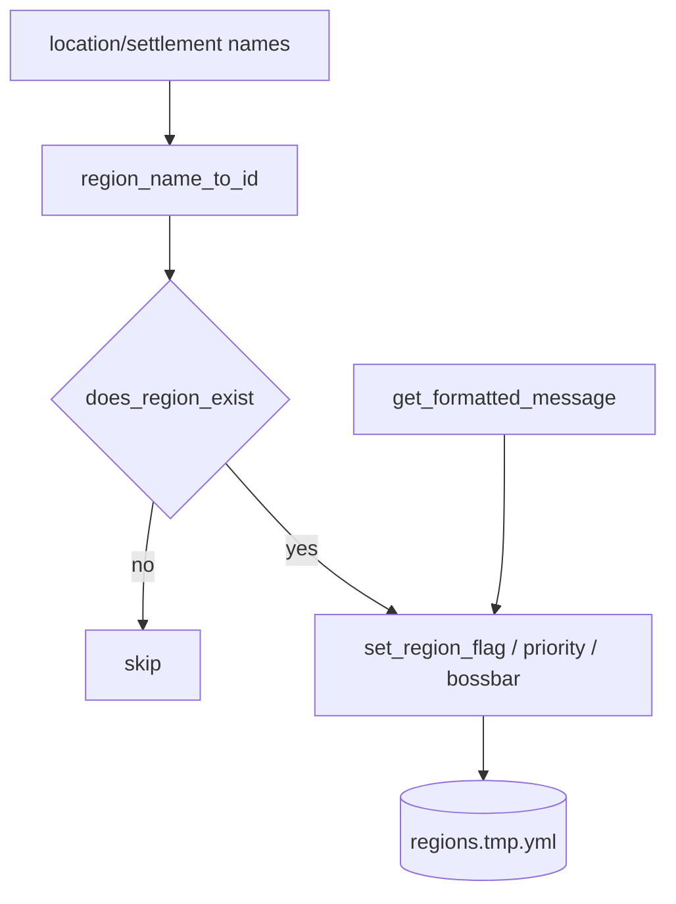

# WorldGuard regions

**File:** `scripts/common/worldguard.sh`.

## Purpose

Translate a semantic location model (nations, settlements, buildings, structures, player homes) into WorldGuard region flags, priorities, boss bars, and localised greeting/teleport/farewell messages, written into the temporary regions file.

## Region identity

`region_name_to_id <name>` normalises a display name to an ID: transliterate UTF-8 to ASCII, lowercase, then remove spaces and underscores.

## Region types

- Administrative: `country`, `county`, `voivodeship`.
- Settlements: `settlement_city`, `settlement_town`, `settlement_village`.
- Bases: `base_player`, `base_military`.
- Borders: `border_crossing`, `border_wall`, `border_watchtower`.
- Defence: `defence_bunker`, `defence_turret`.
- Structures: `bridge`, `end_portal`, `portal_end`, `resource_depot`, `road_rail`, `station_weather`, `yacht_diplomatic`.
- `home`.

## Read helpers

| Function | Role |
|----------|------|
| `get_region_ids <world>` | Lists region IDs from `regions.yml`. |
| `get_region_config <world> <id> <key>` | Reads a region config value. |
| `does_region_exist <world> <id>` | Existence check. |
| `get_regions_by_pattern <pattern>` | Matches IDs in the temporary file. |
| `get_region_colour` / `get_zone_colour` | Colour selection by type. |

## Write helpers

- `set_region_flag <world> <id> <flag> <value>` — writes to the temporary file; maps `false`→`deny`, `true`→`allow`; refuses when the region does not exist.
- `set_region_priority <world> <id> <priority>`.
- `set_region_bossbar <world> <id> <name> [colour]` — only when `RegionBossbar` is installed; deletes then re-adds the entry.

## Message generators

`set_deny_message`, `set_teleport_message`, `set_farewell_message`, `set_greeting_message` produce localised strings and store them as region flags (`deny-message`, `teleport-message`, `farewell`, `greeting`). `set_greeting_messages` composes farewell + greeting. `set_region_messages` selects a type-specific noun (localised) and applies them, optionally suppressing greetings (`--quiet`).

## Composition helpers

- `set_location_region_settings_by_name` / `_by_id` — derive the region ID, apply deny-spawn lists and populate messages/priority for non-player regions.
- `set_settlement_region_settings` — apply settlement flags and then enumerate a large catalogue of building types via `set_building_settings`, plus player homes.
- `set_building_settings` — per-building flags/priority; the `bank` type recursively configures `bank_vault1..50`.
- `set_structure_region_settings` — apply settings to every matching structure region.
- `set_administrative_region_settings` — country/county/voivodeship boss bar, priority, and `passthrough`.
- `set_nation_region_settings` — iterate border crossings, structures, and player regions across nations.

## Data flow

Writes target `WORLDGUARD_WORLD_REGIONS_TEMPORARY_FILE`; `WORLDGUARD_WORLD_REGIONS_FILE` is read (and rewritten only by `change-player-username.sh`).

## Caveats

Several message functions reference an undefined `REGION_TYPE_ID` variable in preference to their `REGION_TYPE` parameter (recorded in [ambiguities-and-open-questions.md](../ambiguities-and-open-questions.md)). `set_location_region_settings_by_id` shadows its `WORLD_NAME` parameter with a local `world`. The `DENY_SPAWN_*` lists enumerate hostile/ambient mobs to deny.

## Related documentation

- [components/messaging-and-localisation.md](./messaging-and-localisation.md)
- [data-model.md](../data-model.md)
