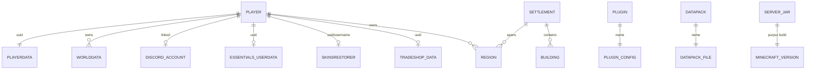

# Data model

## Overview

The toolkit owns no database. Its data model is a set of files on the host filesystem: declarative configuration, JVM-owned runtime game state, plugin-owned data, and generated artefacts. This document maps the entities and their relationships; storage and lifecycle detail lives in [state-and-persistence.md](./state-and-persistence.md).

## Entities

### Player

Identified by a UUID. Resolution order (`get_player_uuid`): player cache → `usercache.json` → `whitelist.json` → `ops.json` → deterministic offline UUID.

The offline UUID is computed as: MD5 of `OfflinePlayer:<username>`, reformatted to a byte array, with version and variant bits set (byte 6 `& 0x0f | 0x30`, byte 8 `& 0x3f | 0x80`), then hyphenated.

### Player attributes

| Attribute | Resolution order | Notes |
|-----------|-----------------|-------|
| Username | cache → Essentials `last-account-name` → usercache → whitelist → ops → `lastKnownName` (playerdata) | Cached back to the player cache. |
| IP | Essentials `ip-address` | — |
| Discord ID | cache → `DiscordSRV/accounts.aof` → `DiscordSRV/linkedaccounts.json` | Cached. |
| First seen | cache → playerdata `firstPlayed` (ms → s) → AuthMe log "registered" | Cached. |
| Last seen | playerdata `lastPlayed` (ms → s) | — |
| Location | playerdata `Pos` via `nbted` | — |
| Spawn | playerdata `SpawnX/Y/Z` via `nbted` | — |
| Password | cache → server logs (`/auth`, `/l`, `/log`, `/login`) | Cached. Sensitive. |
| Playtime | `stats/<uuid>.json` `minecraft:custom."minecraft:play_time"` | Ticks → duration. |
| Wealth | Essentials `money` | Defaults to 0. |

### Region

WorldGuard region referenced by a normalised ID (`region_name_to_id`: transliterate to ASCII, lowercase, strip spaces and underscores). Region types include `base_player`, `base_military`, `border_*`, `bridge`, `defence_*`, `end_portal`, `home`, `portal_end`, `road_rail`, `resource_depot`, `settlement_*`, `station_weather`, `yacht_diplomatic`, and administrative `country`, `county`, `voivodeship`.

### Plugin and datapack

Discovered from the filesystem, not from a manifest. `is_plugin_installed <name>` matches `plugins/<name>-*.jar`; `is_datapack_installed <name>` matches `world/datapacks/<name>*.zip`. Directory names can differ from plugin names (see `get_plugin_dir` in [components/plugin-management.md](./components/plugin-management.md)).

## Relationships

- A **player** owns one playerdata file per world, plus at most one Essentials userdata file, SkinsRestorer records, TradeShop data, and Discord linkage.
- A **region** is owned by at most one player (player home/base regions) or by a settlement/nation hierarchy.
- A **settlement** contains named **buildings**, each a region with derived settings.

## Related documentation

- [components/player-data.md](./components/player-data.md)
- [components/worldguard-regions.md](./components/worldguard-regions.md)
- [state-and-persistence.md](./state-and-persistence.md)
