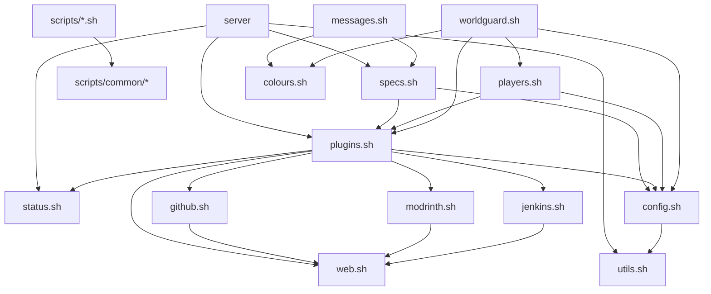

# Dependencies

## External host utilities

| Utility | Required by | Failure behaviour |
|---------|-------------|-------------------|
| `bash` | All scripts | — |
| `jq` | `config.sh`, `github.sh`, `modrinth.sh`, `jenkins.sh`, `players.sh` | `config.sh` exits 400 at load if missing |
| `yq` | `config.sh` | `config.sh` exits 400 at load if missing; per-call error otherwise |
| `xmlstarlet` | `config.sh` | `config.sh` exits 400 at load if missing |
| `curl` | Provider adapters, `update-server.sh` | Empty response → item skipped |
| `wget` | `web.sh` | Download fails silently/partially |
| `tmux` | `server` controller | Session operations fail |
| `tar` | `server backup` | Exit 11 |
| `gawk` | `server status` | Memory summary fails |
| `nbted` | `players.sh` location/spawn | Empty values returned |
| `iconv`, `tr`, `sed`, `awk`, `grep`, `find` | Various | Core POSIX tools |
| `sudo` | `run_with_privileges` | Only when not root/minecraft |

Java 16+ is required to run the server jar. `lighttpd` + `php-cgi` are optional for web maps.

## External runtime

| Dependency | Integration | Notes |
|------------|-------------|-------|
| PurpurMC | Server jar + build API | Filesystem-deployed; no compile-time coupling |
| Minecraft clients | Game protocol | Owned by the JVM |
| Upstream registries | GitHub, Modrinth, Jenkins, PurpurMC | See [integrations.md](./integrations.md) |

## Internal dependency graph

`paths.sh` is the only dependency root.

## Version pinning

- Minecraft/Purpur line: `MINECRAFT_VERSION` in `specs.sh`.
- Plugins and datapacks: unpinned; latest per provider at update time.
- GitHub Actions: `actions/checkout@v6` (pinned major).

## Related documentation

- [components/common-libraries.md](./components/common-libraries.md)
- [integrations.md](./integrations.md)