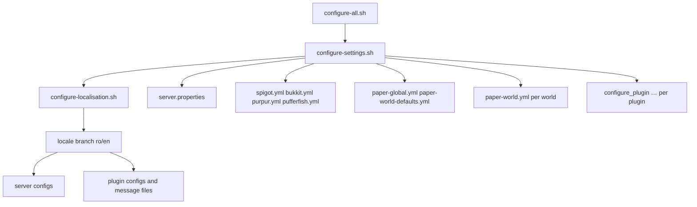

# Flow: configuration

Triggered by `sh scripts/configure-all.sh`, which runs `configure-settings.sh` then `configure-localisation.sh`.

## Sequence

## Settings (`configure-settings.sh`)

Sources `paths.sh`, `colours.sh`, `config.sh`, `messages.sh`, `plugins.sh`, `specs.sh`, `utils.sh`. Applies, in order:

1. `SERVER_PROPERTIES_FILE` — transfers, flight, difficulty, profile, players, compression, simulation/view distance, spawn protection, chunk writes.
2. `SPIGOT_CONFIG_FILE` — logging, despawn rates, activation range, merge radii, mob spawn range, per-world distances (end/nether).
3. `BUKKIT_CONFIG_FILE` — chunk GC, connection throttle, query, spawn limits, autosave.
4. `PAPER_GLOBAL_CONFIG_FILE` — block updates, chunk loading, console permissions, packet limiter, proxies, timings, update checker.
5. `PAPER_WORLD_DEFAULT_CONFIG_FILE` — chunks, collisions, entities, environment, fixes, hopper, lootables, spawn, tick rates.
6. Per-world `paper-world.yml` — autosave interval and spawn keep-loaded.
7. `PUFFERFISH_CONFIG_FILE`.
8. `PURPUR_CONFIG_FILE`.
9. `configure_plugin` blocks (guarded per plugin).

## Localisation (`configure-localisation.sh`)

1. `ensure_su_access`.
2. Build the placeholder constant set.
3. Select the `ro`/`en` branch, defining the shared message variables.
4. Write server-level messages (`bukkit.yml`, `paper-global.yml`, `purpur.yml`, `spigot.yml`).
5. Write plugin messages via `configure_plugin` blocks guarded by `is_plugin_installed`, each with localised text variants.

## Idempotency

- Empty values delete keys; missing files are skipped.
- XML writes occur only on change.
- Running twice produces no additional effect.

## Guarding

Every plugin-specific write is wrapped in `if is_plugin_installed '<name>'; then … fi`, or `configure_plugin` internally returns when the plugin is absent. This is what allows one configuration set to be applied across hosts with different plugin sets.

## Reload behaviour

`configure_plugin` calls `reload_plugin` after writing. `reload_plugin` returns immediately unless the server is running, so configuration can be applied either while running (with live reload) or stopped (applied on next start).

## Known inconsistencies

Some `configure_plugin` invocations contain duplicate keys within one call (the last wins) and a few contain typographical inconsistencies in message values. These are recorded in [ambiguities-and-open-questions.md](../ambiguities-and-open-questions.md).

## Related documentation

- [configuration.md](../configuration.md)
- [behaviour/configuration-provisioning.md](../behaviour/configuration-provisioning.md)
- [components/configuration-writers.md](../components/configuration-writers.md)
