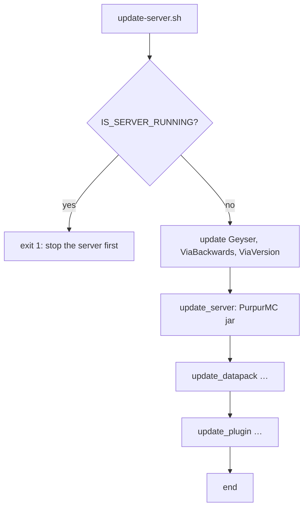

# Flow: provisioning

Triggered by `sh scripts/update-server.sh` (manually, while the server is stopped).

## Sequence

## Server jar

`update_server`:

1. `GET https://api.purpurmc.org/v2/purpur/<MINECRAFT_VERSION>` → `.builds.latest`.
2. `download_file https://api.purpurmc.org/v2/purpur/<version>/<build>/download purpur-<version>-<build>.jar`.

The jar is written into the repository root (the working directory of `download_file`).

## Plugins and datapacks

`update_plugin`/`update_datapack` (see [components/plugin-management.md](../components/plugin-management.md)) are invoked with a display name, a URL, and usually an asset filename pattern. Routing selects the provider by URL substring.

### Notable entries

- **Geyser** — from Modrinth, pattern `Geyser-Spigot-%pluginVersion%.jar`.
- **ViaBackwards / ViaVersion** — GitHub, default pattern.
- **AnarchyExploitFixes** — Modrinth, `%pluginName%-Folia-%pluginVersion%.jar`.
- **ChestShop-3 / ChestShopNotifier** — Jenkins at `ci.minebench.de`, explicit artifact names.
- **CoreProtect** — Modrinth, `%pluginName%-CE-%pluginVersion%.jar`.
- **spark** — Jenkins at `ci.lucko.me`, `%pluginName%-Bukkit-%pluginVersion%.jar`.
- **VotingPlugin** — Jenkins at `bencodez.com`.
- **ProAntiTab** — GitHub with prereleases allowed (`true`).
- **FastAsyncWorldEdit, WorldGuard, LuckPerms, PlaceholderAPI, DeluxeMenus, ViewDistanceTweaks, WanderingTrades, InteractionVisualizer** — alternative provider URLs shown commented in some cases.

Several entries are commented out (disabled) or marked `TODO`, indicating items updated manually or pending implementation. See [behaviour/artefact-updates.md](../behaviour/artefact-updates.md).

## Ordering significance

The plugin updates run before `update_server`. Geyser/Via are grouped first as "important to be up-to-date for maintenance". The Purpur jar update is placed after the plugins.

## Replacement semantics

- `download_plugin` removes the previous `<name>-*.jar` before moving the new file into `plugins/`, chowns it `minecraft:minecraft`, and chmods `+x`.
- `download_datapack` removes previous `<name>-*.zip` files.
- Zero-byte downloads are removed by `download_file`.

## Failure semantics

- Running server → exit 1 (no partial updates).
- A provider returning no version → that item is skipped.
- `MINECRAFT_VERSION` is pinned in `specs.sh`; a change to it changes the requested Purpur line.

## Related documentation

- [components/provider-adapters.md](../components/provider-adapters.md)
- [integrations.md](../integrations.md)
- [behaviour/artefact-updates.md](../behaviour/artefact-updates.md)
