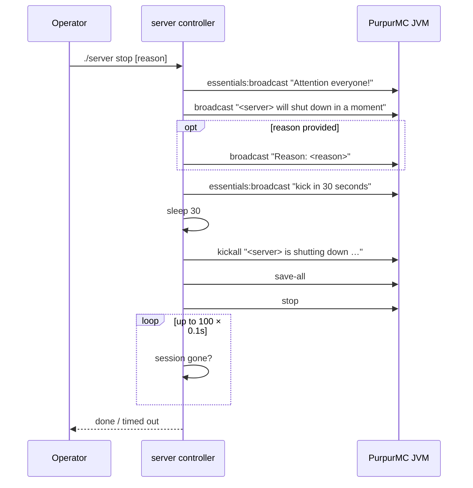
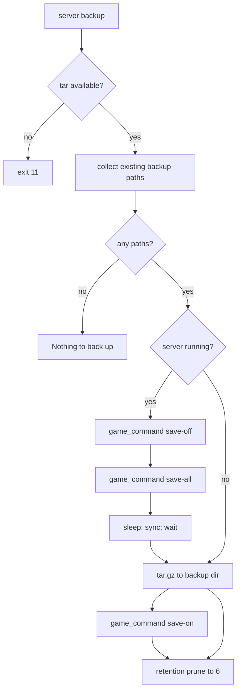

# Flow: shutdown and backup

## Shutdown (`./server stop [reason]`)

- All broadcast texts are localised on `LOCALE` (`ro`/`en`).
- `SECONDS_BEFORE_KICK=30`.
- When no session exists, the controller prints that the session was already dead.
- The `reason` argument becomes part of the kick reason.

## Backup (`./server backup`)

- Backup items are filtered to those that exist: `data`, `plugins`, `world`, `world_nether`, `world_the_end`, `server.properties`, `cache/players.json`, `banned-players.json`, `whitelist.json`.
- Archive name: `<timestamp>.tar.gz` under `/var/backups/minecraft/<session>/`.
- The `tar` invocation runs from `SERVER_ROOT_DIR` and filters the "Removing leading" notice.
- Retention: `ls -tp *.tar.gz | tail -n +7 | xargs -r rm` removes everything beyond the six newest.

## Causal guarantees

- A running server is quiesced (`save-off` then `save-all`) before archiving, giving a consistent snapshot, and resumed (`save-on`) after.
- A stopped server archives without save toggling.
- The backup directory is created if absent.

## Failure modes

| Condition | Result |
|-----------|--------|
| `tar` missing | exit 11 |
| Nothing to back up | informational message, no archive |
| Server stopped | direct archive, no save toggling |

## Related documentation

- [components/server-controller.md](../components/server-controller.md)
- [state-and-persistence.md](../state-and-persistence.md)
