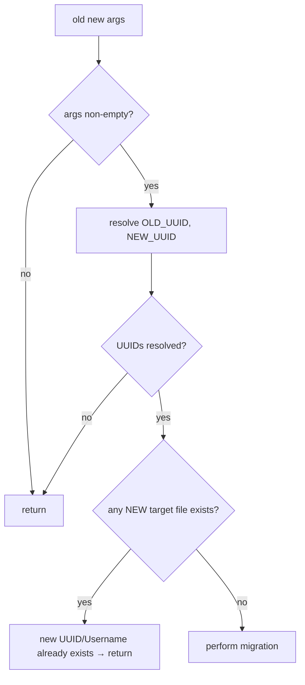

# Flow: username migration

Triggered by `sh scripts/change-player-username.sh <old-username> <new-username>`.

## Purpose

Rewrite all references to a player's old UUID/username to the new one across Discord, Essentials, SkinsRestorer, TradeShop, WorldGuard, advancements, playerdata, stats, and whitelist.

## Preconditions (fail-closed)

The existence check covers: Essentials `<newUUID>.yml`, SkinsRestorer caches/players/skins, TradeShop `<newUUID>.json`, advancements, playerdata (`.dat` and `.dat_old`), and stats. Any existing target aborts the whole operation before mutation.

## Mutation sequence

1. `sed` UUID replacement in `DiscordSRV/accounts.aof` → reload DiscordSRV.
2. Move Essentials userdata `<oldUUID>.yml` → `<newUUID>.yml` → reload Essentials.
3. Move SkinsRestorer cache, legacy player/skin, player, and custom skin files (username-keyed ones renamed by username; UUID-keyed ones by UUID) → reload SkinsRestorer.
4. Move TradeShop `<oldUUID>.json` → `<newUUID>.json` → reload TradeShop.
5. `sed` UUID replacement in the WorldGuard world regions file → reload WorldGuard.
6. Move advancements, playerdata (`.dat`, `.dat_old`), and stats by UUID.
7. `sed` UUID and username replacement in `whitelist.json`.
8. Run `fix-permissions.sh`.

## Postconditions

- Every listed file is keyed to the new UUID/username.
- Plugins are reloaded so in-memory state matches disk.
- File ownership and modes are restored.

## Caveats

- The player cache (`cache/players.json`) is **not** updated or cleared; stale UUID→username mappings may persist.
- `move_file` refuses when the destination exists; because the precondition already excludes those cases, moves should succeed, but a partially migrated state can arise if a later step fails after earlier moves.
- The stats move targets `WORLD_PLAYERDATA_DIR` rather than `WORLD_STATS_DIR` (recorded in [ambiguities-and-open-questions.md](../ambiguities-and-open-questions.md)), so the source `/stats/<uuid>.json` is not found and the operation silently no-ops for that step.

## Related documentation

- [components/player-data.md](../components/player-data.md)
- [state-and-persistence.md](../state-and-persistence.md)
- [behaviour/player-management.md](../behaviour/player-management.md)
