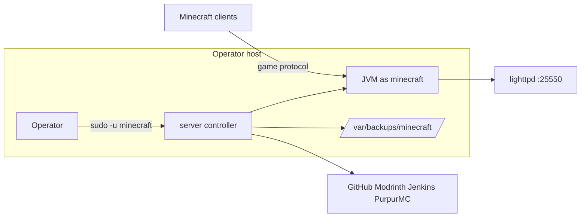

# Security

This document elaborates on the root [`SECURITY.md`](../SECURITY.md). It does not restate the disclosure policy.

## Trust boundaries

1. **Operator ↔ controller:** the controller explicitly authenticates to the `minecraft` user and aborts otherwise.
2. **Network ↔ JVM:** the game port; `connection-throttle` limits reconnect abuse; `online-mode` is read from `server.properties`.
3. **Controller ↔ providers:** HTTPS-only, public endpoints, no credentials.
4. **Web server ↔ browser:** lighttpd serves rendered maps; access control is a host concern.

## Privilege handling

- `run_with_privileges` runs directly when EUID 0 or the user is `minecraft`, otherwise `sudo`.
- The controller verifies `${SUDO_CMD} whoami` equals `minecraft` before acting.
- Files placed by downloads are chowned `minecraft:minecraft`; `fix-permissions.sh` restores ownership and modes.

## Secrets and sensitive data

- Plugin telemetry is **disabled by default** (`USE_TELEMETRY=false`), the bStats server UUID is zeroed, and `timings` is disabled.
- Plugin update checks are skipped by default (`SKIP_PLUGIN_UPDATE_CHECKS=true`, `CHECK_PLUGINS_FOR_UPDATES=false`).
- Sensitive files are excluded from version control (`.gitignore`): `server.properties`, `ops.json`, `whitelist.json`, `banned-*.json`, `eula.txt`, `usercache.json`, world and plugin directories.
- Player passwords, IP addresses, and Discord IDs are surfaced on demand by `players.sh`; the toolkit does not redact them.

## Data protection controls

| Control | Mechanism |
|---------|-----------|
| Least privilege | `minecraft` user; `run_with_privileges` escalation only when needed |
| Telemetry opt-in | `USE_TELEMETRY` flag |
| Update-check opt-in | `CHECK_PLUGINS_FOR_UPDATES`, `SKIP_PLUGIN_UPDATE_CHECKS` |
| Backup confidentiality | Host filesystem controls under `/var/backups/minecraft/` |
| Secrets exclusion | `.gitignore` |

## Threat considerations

| Threat | Mitigation in scope |
|--------|---------------------|
| Unauthorised operator | Requires `minecraft`-capable local access |
| Malicious plugin/datapack | None in scope; artefacts come from trusted providers |
| Reconnect abuse | `connection-throttle` |
| Credential exposure in logs | Out of scope for the toolkit; operator responsibility |
| Download tampering | Not verified (no checksum/signature validation) — see [ambiguities-and-open-questions.md](./ambiguities-and-open-questions.md) |

## Related documentation

- [components/player-data.md](./components/player-data.md)
- [logging.md](./logging.md)
- [integrations.md](./integrations.md)